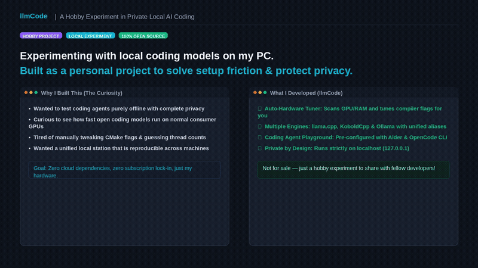

# llmCode

[](LICENSE)

Unified local LLM server and coding station supporting **Windows**, **Linux**, and **macOS**.
Scans your hardware & packages into `config/hardware.json`, auto-tunes `llama.cpp`, `KoboldCpp`, and `Ollama` compilation & settings, installs **Aider** and **OpenCode** inside the `llm-dash` virtual environment, and configures **VS Code Continue** with standard aliases (`llamacpp`, `koboldcpp`, `ollama`).

<p align="center">
  
</p>
<p align="center">
  <em>Local LLM station: auto-hardware scan, auto-tuned compilation, and instant Aider / OpenCode agent integration. (<a href="assets/demo.mp4">Download 1080p MP4</a>)</em>
</p>

---

## 1. Windows Setup & Usage

```cmd
:: 1. Scan hardware, compile/download backends, install Aider & OpenCode in .venv, configure Continue
:: (Automatically performs incremental updates after git pull; use --full to force complete setup)
setup.bat

:: 2. Launch llm-dash in background and open browser (http://127.0.0.1:7860)
launch.bat

:: 3. Stop llm-dash and active inference backends
stop.bat

:: 4. Full uninstall (removes .venv, compiled engines, binaries, models, configs, logs)
setup.bat --uninstall
```

---

## 2. Linux Setup & Usage

```bash
# 1. Scan hardware, compile/download backends, install Aider & OpenCode in .venv, configure Continue
# (Automatically performs incremental updates after git pull; use --full to force complete setup)
./setup.sh

# 2. Launch llm-dash in background and open browser (http://127.0.0.1:7860)
./launch.sh

# 3. Stop llm-dash and active inference backends
./stop.sh

# 4. Full uninstall (removes .venv, compiled engines, binaries, models, configs, logs)
./setup.sh --uninstall
```

---

## 3. macOS Setup & Usage

```bash
# 1. Scan hardware (Apple Metal), compile/download backends, install Aider & OpenCode in .venv, configure Continue
# (Automatically performs incremental updates after git pull; use --full to force complete setup)
./setup.sh

# 2. Launch llm-dash in background and open browser (http://127.0.0.1:7860)
./launch.sh

# 3. Stop llm-dash and active inference backends
./stop.sh

# 4. Full uninstall (removes .venv, compiled engines, binaries, models, configs, logs)
./setup.sh --uninstall
```

---

## Incremental Post-Pull Updates

Running `setup.sh` or `setup.bat` after `git pull` checks `config/deploy_state.json`:
- **Python dependencies (`requirements.txt`)**: Re-runs `pip install` only.
- **Paths & Config (`paths.py`)**: Auto-syncs `config.json` database.
- **Engine Source (`setup_binaries.py`)**: Prompts before rebuilding/redownloading.
- **Server code (`app.py`, `src/common/`)**: Prompts before restarting active background services.
- Run `python llmcode.py check-update` directly or `./setup.sh --full` to force complete reinstallation.

---

## Security

By default, all services and backends bind strictly to `127.0.0.1` (localhost) with auto-generated session keys stored in `config/api_key` and `config/agent.env`. If exposing across a local network with `--host 0.0.0.0` or `--lan`, ensure you place services behind a firewall or authenticated reverse proxy.

For vulnerability disclosure, please review [SECURITY.md](SECURITY.md).

---

## Contributing

Contributions are welcome! Please read [CONTRIBUTING.md](CONTRIBUTING.md) for development workflows, coding guidelines, and testing procedures.

---

## License

This project is licensed under the [MIT License](LICENSE) - see the [LICENSE](LICENSE) file for details.


